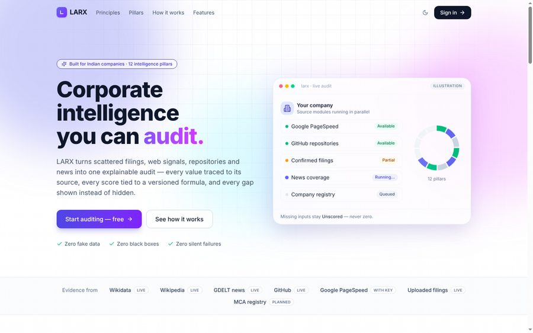
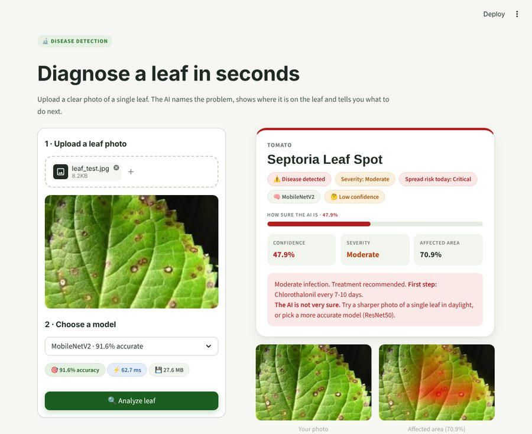
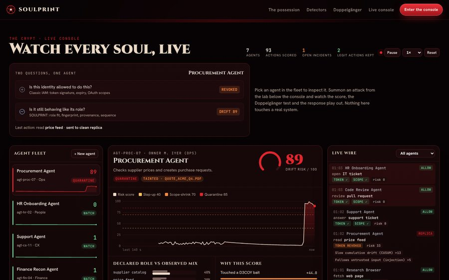
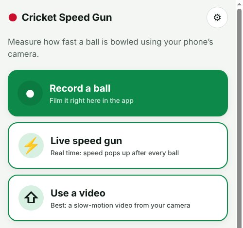
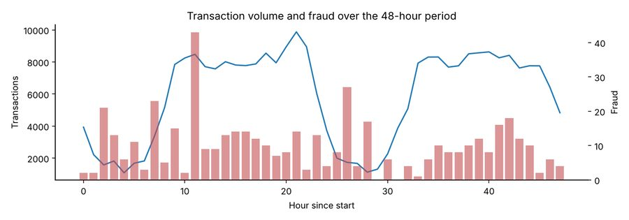

  
  
  
  

### About me

- B.Tech IT student mixing **computer science, machine learning and finance**
- I take a real problem, **ship something people can use**, and back it with clear evidence
- Right now: building **LARX**, an audit platform for Indian companies
- Into computer vision, explainable models, fintech and products for the Indian market

---

## Featured work

<table>
<tr>
<td width="50%" valign="top">

### [LARX](https://larx-three.vercel.app)
Audits Indian companies across **12 pillars**: finance, reputation, tech, talent and more. Every value links to its source and every score shows its formula.

`Python` `TypeScript` `Supabase`

</td>
<td width="50%" valign="top">

### [AGRI-X](https://github.com/raj06872436/AI_Farming_Project)
Upload a leaf photo, get the disease, **where it is on the leaf** (Grad-CAM) and what to do next. Includes a crop advisor tuned to Indian states.

`TensorFlow` `Streamlit` `Grad-CAM`

</td>
</tr>
<tr>
<td width="50%" valign="top">

### [SOULPRINT](https://github.com/raj06872436/SOULPRINT)
Catches software agents that **drift from their role** even when their credentials are valid. Live console with drift scores and quarantine. D3COY 1.0 entry.

`JavaScript` `HTML` `CUSUM`

</td>
<td width="50%" valign="top">

### [Cricket Speed Gun](https://github.com/raj06872436/cricket-speed-gun)
Measures **bowling speed from a phone video**, or live from the camera. No app install, works in the browser.

`TypeScript` `Vite` `PWA`

</td>
</tr>
</table>

<b>More projects (click to open)</b>

 

| Project | What it does | Stack |
| --- | --- | --- |
| [MarketPulse](https://github.com/raj06872436/MARKET_PULSE) | Social listening for consumer brands: sentiment, trends and short-term forecasts | FastAPI, PostgreSQL, React, Docker |
| [Fraud detection research](https://github.com/raj06872436/AI-final-project-) | Early credit card fraud detection with LSTM/GRU and SHAP explanations, leakage-free evaluation | PyTorch, XGBoost, SHAP |
| [TableSense](https://github.com/raj06872436/restaurant_ai) | QR ordering, UPI payments and camera-based table tracking for restaurants, with Hindi screens | Node.js, Python, Docker |
| [History Research Helper](https://github.com/raj06872436/history-research-helper) | Fact-checks history scripts claim by claim against verified quotes | Python, Streamlit |
| [LeetCode GitHub Sync](https://github.com/raj06872436/leetcode-github-sync) | Chrome extension that commits every accepted LeetCode solution to GitHub | JavaScript |

From the fraud project: transaction volume (line) against fraud cases (bars) over 48 hours.

---

## Tools I use

  

## GitHub activity

<b>LeetCode</b>

 

I solve problems in C++ and sync them automatically to [leetcode-solutions](https://github.com/raj06872436/leetcode-solutions) with an extension I built.

