  
  
  
  

<table>
<tr>
<td width="50%"></td>
<td width="50%"></td>
</tr>
<tr>
<td width="50%"></td>
<td width="50%"></td>
</tr>
</table>

<b>&nbsp;+ 5 more projects</b>

 

| | Project | What it does | Stack |
| --- | --- | --- | --- |
| 📈 | [**MarketPulse**](https://github.com/raj06872436/MARKET_PULSE) | Social listening for consumer brands: sentiment, trends and short-term forecasts | FastAPI, PostgreSQL, React, Docker |
| 💳 | [**Fraud detection research**](https://github.com/raj06872436/AI-final-project-) | Early credit card fraud detection with LSTM/GRU and SHAP, evaluated without leakage | PyTorch, XGBoost, SHAP |
| 🍽️ | [**TableSense**](https://github.com/raj06872436/restaurant_ai) | QR ordering, UPI payments and camera-based table tracking for restaurants, Hindi screens included | Node.js, Python, Docker |
| 📜 | [**History Research Helper**](https://github.com/raj06872436/history-research-helper) | Fact-checks history scripts claim by claim against verified quotes | Python, Streamlit |
| 🔁 | [**LeetCode GitHub Sync**](https://github.com/raj06872436/leetcode-github-sync) | Chrome extension that commits every accepted LeetCode solution to GitHub | JavaScript |

From the fraud project: transaction volume (line) against fraud cases (bars) over 48 hours.

  

  

  

  <picture>
    <source media="(prefers-color-scheme: dark)" srcset="https://raw.githubusercontent.com/raj06872436/raj06872436/output/snake-dark.svg" />
    
  </picture>

<b>&nbsp;LeetCode</b>

 

I solve problems in C++ and they sync to [leetcode-solutions](https://github.com/raj06872436/leetcode-solutions) automatically through an extension I built.

