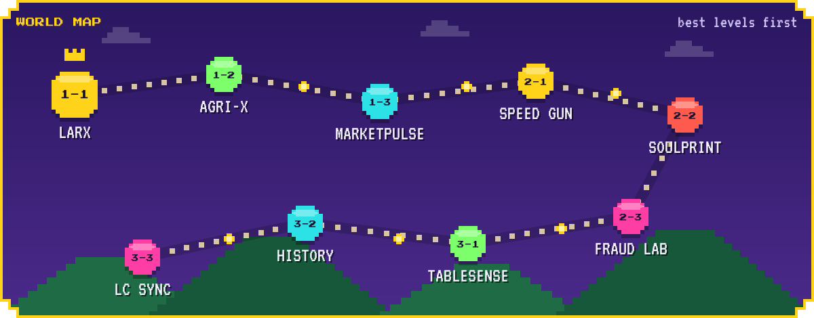
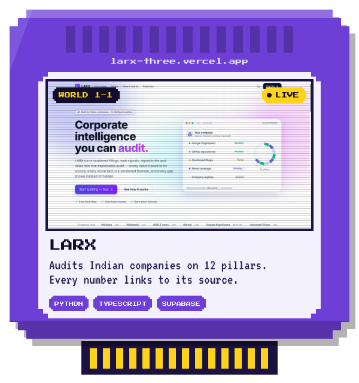
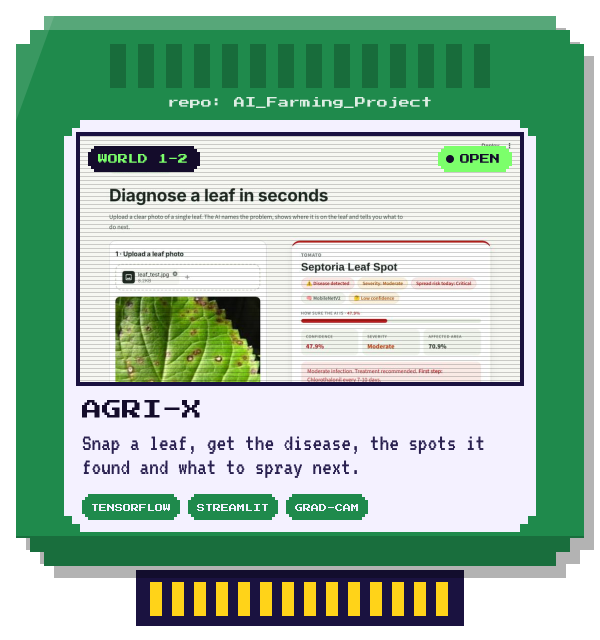
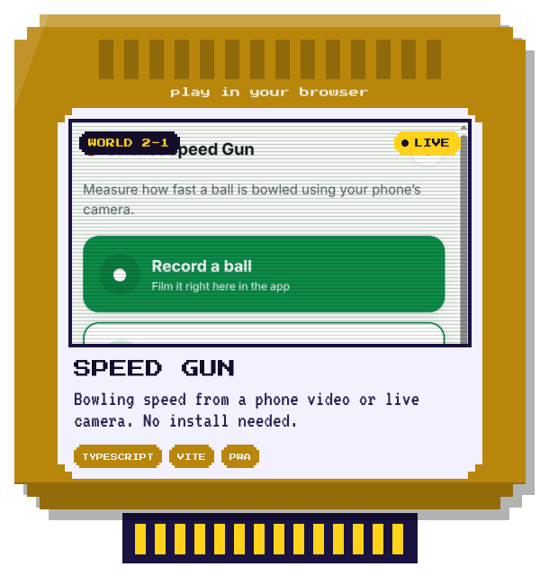

<picture>
  <source media="(prefers-color-scheme: dark)" srcset="assets/hero-dark.svg" />
  <source media="(prefers-color-scheme: light)" srcset="assets/hero-light.svg" />
  
</picture>

  
  
  

<picture>
  <source media="(prefers-color-scheme: dark)" srcset="assets/t-map-dark.svg" />
  <source media="(prefers-color-scheme: light)" srcset="assets/t-map-light.svg" />
  
</picture>
<picture>
  <source media="(prefers-color-scheme: dark)" srcset="assets/map-dark.svg" />
  <source media="(prefers-color-scheme: light)" srcset="assets/map-light.svg" />
  
</picture>

<picture>
  <source media="(prefers-color-scheme: dark)" srcset="assets/t-quests-dark.svg" />
  <source media="(prefers-color-scheme: light)" srcset="assets/t-quests-light.svg" />
  
</picture>

  
  
  
  
  
  

<b>&nbsp;🕹️ Side quests (world 3)</b>

 

| Level | Quest | What it does | Loot |
| :---: | --- | --- | --- |
| 3-1 | [**TableSense**](https://github.com/raj06872436/restaurant_ai) | QR ordering, UPI payments and camera-based table tracking for restaurants, with Hindi screens | Node.js, Python, Docker |
| 3-2 | [**History Research Helper**](https://github.com/raj06872436/history-research-helper) | Fact-checks history scripts claim by claim against verified quotes | Python, Streamlit |
| 3-3 | [**LeetCode GitHub Sync**](https://github.com/raj06872436/leetcode-github-sync) | Chrome extension that commits every accepted LeetCode solution to GitHub ([my solutions](https://github.com/raj06872436/leetcode-solutions)) | JavaScript |

<picture>
  <source media="(prefers-color-scheme: dark)" srcset="assets/t-ach-dark.svg" />
  <source media="(prefers-color-scheme: light)" srcset="assets/t-ach-light.svg" />
  
</picture>
<picture>
  <source media="(prefers-color-scheme: dark)" srcset="assets/ach-dark.svg" />
  <source media="(prefers-color-scheme: light)" srcset="assets/ach-light.svg" />
  
</picture>

<picture>
  <source media="(prefers-color-scheme: dark)" srcset="assets/t-inv-dark.svg" />
  <source media="(prefers-color-scheme: light)" srcset="assets/t-inv-light.svg" />
  
</picture>

  <picture>
    <source media="(prefers-color-scheme: dark)" srcset="https://skillicons.dev/icons?i=python,ts,js,cpp,react,nextjs,nodejs,fastapi,tensorflow,pytorch,postgres,supabase,docker,git,linux,vercel&perline=8&theme=dark" />
    <source media="(prefers-color-scheme: light)" srcset="https://skillicons.dev/icons?i=python,ts,js,cpp,react,nextjs,nodejs,fastapi,tensorflow,pytorch,postgres,supabase,docker,git,linux,vercel&perline=8&theme=light" />
    
  </picture>

<picture>
  <source media="(prefers-color-scheme: dark)" srcset="assets/t-score-dark.svg" />
  <source media="(prefers-color-scheme: light)" srcset="assets/t-score-light.svg" />
  
</picture>

  <picture>
    <source media="(prefers-color-scheme: dark)" srcset="https://streak-stats.demolab.com?user=raj06872436&hide_border=true&border_radius=0&card_width=600&background=140C2B&ring=FF3EA5&fire=FFD319&currStreakNum=FFFFFF&currStreakLabel=FFD319&sideNums=2DE2E6&sideLabels=F4F1FF&dates=8A7FB0&stroke=4B2A8A" />
    <source media="(prefers-color-scheme: light)" srcset="https://streak-stats.demolab.com?user=raj06872436&hide_border=true&border_radius=0&card_width=600&background=FFF4D6&ring=C0156A&fire=B45F00&currStreakNum=1B1340&currStreakLabel=B45F00&sideNums=0B6F80&sideLabels=1B1340&dates=6B5F99&stroke=ECD9A6" />
    
  </picture>

  <picture>
    <source media="(prefers-color-scheme: dark)" srcset="https://raw.githubusercontent.com/raj06872436/raj06872436/output/snake-arcade.svg" />
    <source media="(prefers-color-scheme: light)" srcset="https://raw.githubusercontent.com/raj06872436/raj06872436/output/snake-arcade-light.svg" />
    
  </picture>

<picture>
  <source media="(prefers-color-scheme: dark)" srcset="assets/footer-dark.svg" />
  <source media="(prefers-color-scheme: light)" srcset="assets/footer-light.svg" />
  
</picture>
