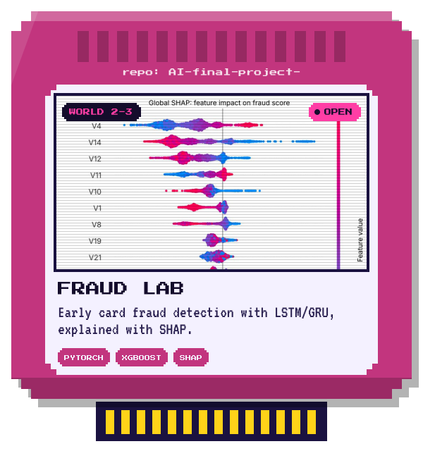
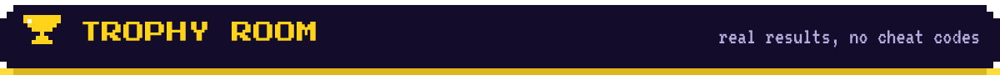
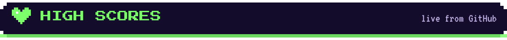
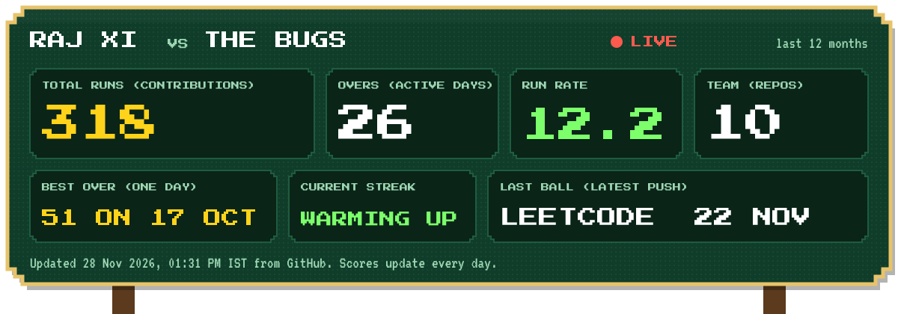
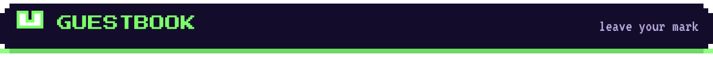

<picture>
  <source media="(prefers-color-scheme: dark)" srcset="assets/hero-dark.svg" />
  <source media="(prefers-color-scheme: light)" srcset="assets/hero-light.svg" />
  
</picture>

  
  
  

  
  
  

<picture>
  <source media="(prefers-color-scheme: dark)" srcset="assets/t-map-dark.svg" />
  <source media="(prefers-color-scheme: light)" srcset="assets/t-map-light.svg" />
  
</picture>
<picture>
  <source media="(prefers-color-scheme: dark)" srcset="assets/map-dark.svg" />
  <source media="(prefers-color-scheme: light)" srcset="assets/map-light.svg" />
  
</picture>

<picture>
  <source media="(prefers-color-scheme: dark)" srcset="assets/t-quests-dark.svg" />
  <source media="(prefers-color-scheme: light)" srcset="assets/t-quests-light.svg" />
  
</picture>

  
  
  
  
  
  

<b>&nbsp;🕹️ Side quests (world 3)</b>

 

| Level | Quest | What it does | Loot |
| :---: | --- | --- | --- |
| 3-1 | [**TableSense**](https://github.com/raj06872436/restaurant_ai) | QR ordering, UPI payments and camera-based table tracking for restaurants, with Hindi screens | Node.js, Python, Docker |
| 3-2 | [**History Research Helper**](https://github.com/raj06872436/history-research-helper) | Fact-checks history scripts claim by claim against verified quotes | Python, Streamlit |
| 3-3 | [**LeetCode GitHub Sync**](https://github.com/raj06872436/leetcode-github-sync) | Chrome extension that commits every accepted LeetCode solution to GitHub ([my solutions](https://github.com/raj06872436/leetcode-solutions)) | JavaScript |

<picture>
  <source media="(prefers-color-scheme: dark)" srcset="assets/t-ach-dark.svg" />
  <source media="(prefers-color-scheme: light)" srcset="assets/t-ach-light.svg" />
  
</picture>
<picture>
  <source media="(prefers-color-scheme: dark)" srcset="assets/ach-dark.svg" />
  <source media="(prefers-color-scheme: light)" srcset="assets/ach-light.svg" />
  
</picture>

<picture>
  <source media="(prefers-color-scheme: dark)" srcset="assets/t-inv-dark.svg" />
  <source media="(prefers-color-scheme: light)" srcset="assets/t-inv-light.svg" />
  
</picture>

  <picture>
    <source media="(prefers-color-scheme: dark)" srcset="https://skillicons.dev/icons?i=python%2Cts%2Cjs%2Ccpp%2Creact%2Cnextjs%2Cnodejs%2Cfastapi%2Ctensorflow%2Cpytorch%2Cpostgres%2Csupabase%2Cdocker%2Cgit%2Clinux%2Cvercel&perline=8&theme=dark" />
    <source media="(prefers-color-scheme: light)" srcset="https://skillicons.dev/icons?i=python%2Cts%2Cjs%2Ccpp%2Creact%2Cnextjs%2Cnodejs%2Cfastapi%2Ctensorflow%2Cpytorch%2Cpostgres%2Csupabase%2Cdocker%2Cgit%2Clinux%2Cvercel&perline=8&theme=light" />
    
  </picture>

<picture>
  <source media="(prefers-color-scheme: dark)" srcset="assets/t-score-dark.svg" />
  <source media="(prefers-color-scheme: light)" srcset="assets/t-score-light.svg" />
  
</picture>

  

  <picture>
    <source media="(prefers-color-scheme: dark)" srcset="https://raw.githubusercontent.com/raj06872436/raj06872436/output/snake-arcade.svg" />
    <source media="(prefers-color-scheme: light)" srcset="https://raw.githubusercontent.com/raj06872436/raj06872436/output/snake-arcade-light.svg" />
    
  </picture>

<picture>
  <source media="(prefers-color-scheme: dark)" srcset="assets/t-guest-dark.svg" />
  <source media="(prefers-color-scheme: light)" srcset="assets/t-guest-light.svg" />
  
</picture>
<picture>
  <source media="(prefers-color-scheme: dark)" srcset="https://raw.githubusercontent.com/raj06872436/raj06872436/output/guestbook-dark.svg" />
  <source media="(prefers-color-scheme: light)" srcset="https://raw.githubusercontent.com/raj06872436/raj06872436/output/guestbook-light.svg" />
  
</picture>

  

<b>&nbsp;↑ ↑ ↓ ↓ ← → ← → B A</b>

 

**Cheat code accepted.** Some things you can't see from the outside:

- The batter on the title screen is drawn square by square in code. No image editor was used.
- Every letter on this page is drawn as shapes, so the pixel font looks the same on any device.
- The scoreboard and the guestbook redraw themselves every day.
- AGRI-X's LesionNet still gets 98.7% right when the photo background is swapped out. Standard models drop to 45-81%.
- Speed Gun is most accurate with slow-motion video at 120 or 240 frames per second.

<picture>
  <source media="(prefers-color-scheme: dark)" srcset="assets/footer-dark.svg" />
  <source media="(prefers-color-scheme: light)" srcset="assets/footer-light.svg" />
  
</picture>
