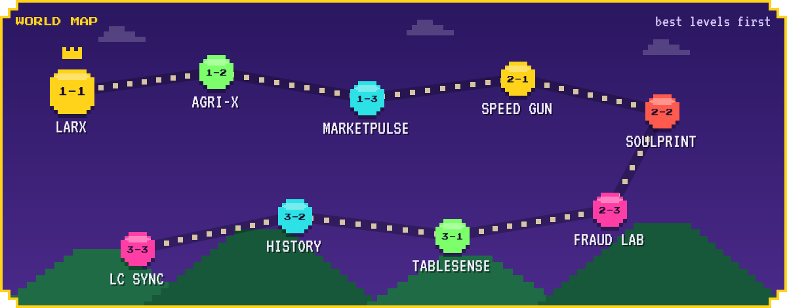
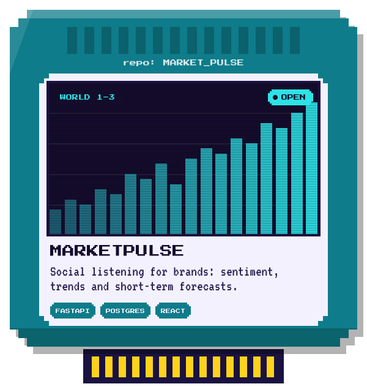
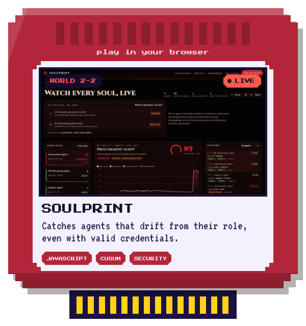

  
  
  

  
  
  
  
  
  

<b>&nbsp;🕹️ Side quests (world 3)</b>

 

| Level | Quest | What it does | Loot |
| :---: | --- | --- | --- |
| 3-1 | [**TableSense**](https://github.com/raj06872436/restaurant_ai) | QR ordering, UPI payments and camera-based table tracking for restaurants, with Hindi screens | Node.js, Python, Docker |
| 3-2 | [**History Research Helper**](https://github.com/raj06872436/history-research-helper) | Fact-checks history scripts claim by claim against verified quotes | Python, Streamlit |
| 3-3 | [**LeetCode GitHub Sync**](https://github.com/raj06872436/leetcode-github-sync) | Chrome extension that commits every accepted LeetCode solution to GitHub ([my solutions](https://github.com/raj06872436/leetcode-solutions)) | JavaScript |

  

  

  

